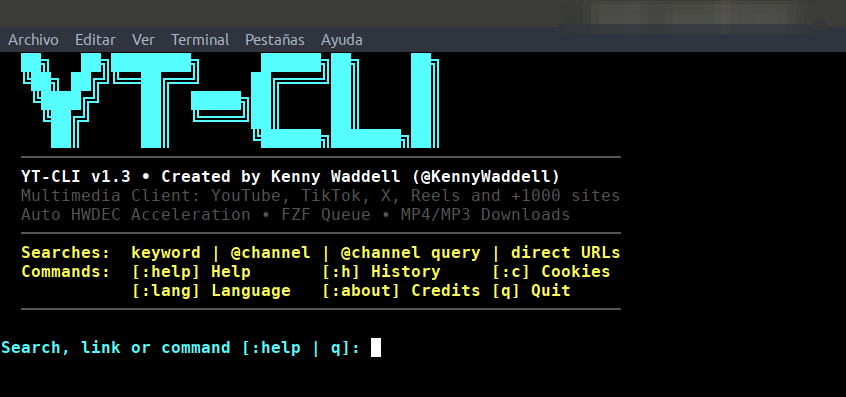
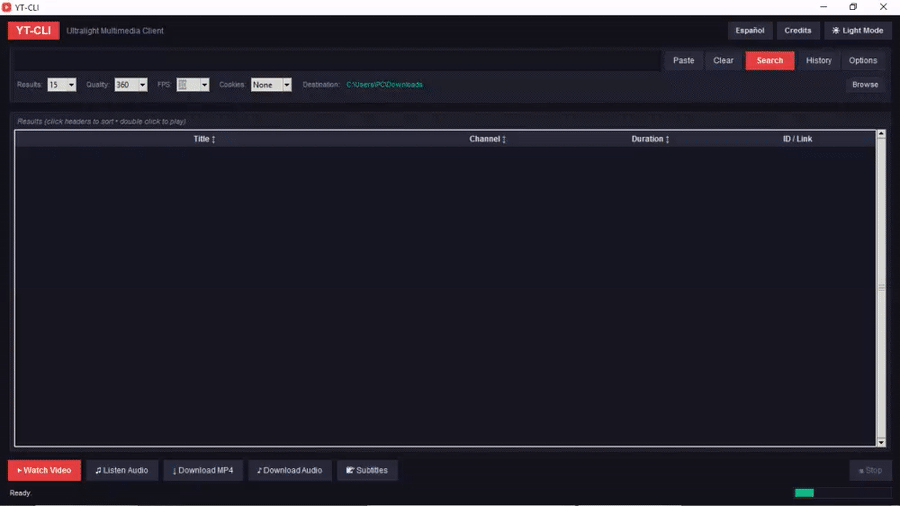

# 🎬 YT-CLI

<p align="center">
  <b><a href="README.md">English Version</a></b> • <b>Español</b>
</p>

> **Cliente y Gestor Multimedia Ultraligero para Terminal en Linux y GUI Portable en Windows**  
> Diseñado específicamente para equipos de recursos limitados (Intel Celeron, Atom, ThinkPads clásicas y PCs con 2 GB de RAM). Compatible con Linux y Windows 7, 8.1, 10 y 11.

[](LICENSE)
[](#requisitos-del-sistema)
[](#instalación-rápida-en-linux)
[-orange.svg)](#uso-en-windows-portable)
[](#características-principales)

<p align="center">
  
</p>

---

## ⚡ El Problema que Resuelve

Creé YT-CLI por necesidad propia: mi equipo de bajos recursos en Linux se congelaba al intentar ver vídeos de YouTube dentro de Brave.

En navegadores web modernos (Brave, Chrome, Firefox), abrir YouTube consume entre **900 MB y 1.4 GB de RAM**, además de disparar la CPU al **100%** debido a cientos de scripts JavaScript, telemetría y renderizado pesado del DOM. En procesadores modestos de 2 núcleos, esto provoca congelamientos, altas temperaturas y videos con tirones.

**YT-CLI** elimina por completo el navegador de la ecuación:
* Realiza búsquedas instantáneas en texto plano con **FZF**.
* Transmite el flujo de video directamente a **MPV**.
* Negocia decodificación agnóstica por hardware (`--hwdec=auto-safe`: Intel VA-API, AMD Mesa, Nvidia NVDEC) priorizando el códec **H.264 (AVC) a un máximo de 30 fps** para cuidar tu CPU de códecs pesados como VP9 o AV1.

| Métrica | YouTube en Navegador Web | YT-CLI + MPV |
| :--- | :--- | :--- |
| **Consumo de Memoria RAM** | ~1.100 MB (1.1 GB) | **~75 MB - 110 MB** (Ahorro del 90%) |
| **Carga de CPU en Reproducción** | 80% - 100% (Lags y calor) | **15% - 25%** (Fluido a 60/30fps) |
| **Modo Solo Audio (Música/Podcast)** | 600 MB - 800 MB | **~25 MB** |
| **Privacidad** | Rastreadores y telemetría en la nube | **100% Privado (Cero telemetría / Historial solo local y opcional)** |

> **Entornos de Prueba:** Métricas de referencia medidas en hardware dual-core de bajos recursos con gráfica integrada (H.264 720p@30fps vía `d3d11va`/`vaapi`). Probado en **Debian Linux**, **Windows 10 (1609 LTSB)** y **Windows 8.1 Lite** (compilado con Python 3.8.10 para compatibilidad con Windows 7 SP1; validación en Win7 en curso).

---

## 🥊 ¿En qué se diferencia YT-CLI de ytfzf?

Si conoces herramientas de terminal como `ytfzf`, te preguntarás en qué se diferencian:

1. **Cero configuración previa (Out-of-the-Box):** `ytfzf` requiere editar archivos de configuración y scripts para forzar perfiles ligeros en equipos antiguos. `YT-CLI` viene preajustado desde el primer segundo con filtros H.264 y aceleración de hardware segura (`auto-safe`) para que una laptop modesta no sufra congelamientos.
2. **Experiencia Multiplataforma Unificada:** `ytfzf` está limitado a sistemas POSIX (Linux/macOS/BSD). `YT-CLI` ofrece una suite completa: terminal CLI pura en Linux y aplicación gráfica nativa y portable (`YT-CLI.exe`) para Windows 7, 8.1, 10 y 11.
3. **Gestor de Descargas Completo Integrado:** Mientras que `ytfzf` está pensado primordialmente para visualización, `YT-CLI` incluye un gestor completo de descargas con selector de carpetas (incluyendo pendrives USB montados), reanudación automática (`--continue`), conversión de audio a MP3 (320 kbps) con carátula y etiquetas ID3, y descarga de videos en MP4.
4. **Búsqueda por Canales y Creadores:** Búsqueda directa dentro de canales de YouTube escribiendo `@canal` o `@canal término de búsqueda`.
5. **Filosofía UNIX sin hacks gráficos en terminal:** Mientras que herramientas como `ytfzf` dependen de configuraciones complejas para emular imágenes en terminales de texto (que suelen distorsionarse o parpadear según la fuente y el emulador), `YT-CLI` mantiene su cliente de Linux como una herramienta CLI pura, ultrarrápida y libre de distracciones, reservando la previsualización visual nativa para la interfaz de Windows.

---

## ✨ Características Principales

* 🔍 **Buscador interactivo ultrarrápido:** Filtra en tiempo real por título, duración y canal mediante el teclado con `fzf`.
* 🎶 **Cola de reproducción y selección múltiple:** Marca varios videos o canciones con la tecla `Tab` en `fzf` para reproducirlos en cola continua en MPV (`>` siguiente / `<` anterior) o descargarlos en lote.
* 📋 **Detección automática del portapapeles:** Al arrancar, si tienes copiado un enlace de YouTube, TikTok, X (Twitter), etc., `yt-cli` lo detecta automáticamente y te ofrece abrirlo o descargarlo al instante.
* 🔄 **Lista de resultados persistente y navegación segura:** Cuando un video termina (o pulsas `q` para cerrarlo), la lista de búsqueda anterior **reaparece al instante**. Además, si seleccionas un video por error en FZF, el menú de acciones incluye la opción `[0]` para cancelar y regresar inmediatamente a tus resultados sin recargar nada.
* 📺 **Selector de resoluciones inteligente:**
  * **720p HD a 30fps:** El equilibrio perfecto para pantallas de portátiles y bajo consumo de CPU.
  * **1080p Full HD:** Forzando códec H.264 acelerado por GPU (con fallback suave a 720p si el video no dispone de H.264 para proteger tu CPU de códecs pesados como AV1 o VP9).
  * **480p / 360p:** Para conexiones lentas o ahorro extremo de energía.
  * **Solo Audio:** Ideal para podcasts, conferencias o música de fondo consumiendo apenas 25 MB de RAM.
* ⬇️ **Descargas inteligentes y reanudables:**
  * **Recorte de fragmentos por tiempo (`--section` / `[9]`):** Descarga solo el intervalo exacto que necesitas de vídeos largos o tutoriales (ej: `--section 00:10:00-00:25:00`).
  * **División por capítulos (`--split-chapters` / `-s`):** Separa automáticamente álbumes completos, podcasts y cursos en pistas individuales sin re-codificar.
  * **Transcripciones limpias en texto (`-t` / `[t]`):** Extrae los subtítulos en un archivo `.txt` continuo y legible (junto al `.srt`) para estudiar o leer rápido sin descargar el vídeo.
  * **Formatos de audio avanzados:** Elige entre **M4A/AAC** u **Opus** nativos de YT (copia directa del stream original con carátula oficial y cero pérdida por compresión) o **MP3** tradicional (320k, 192k, 128k) y **FLAC**.
  * **Historial de descargas seguras:** Registra los vídeos ya descargados (`--download-archive`), de modo que al bajar listas o canales enteros se salten al instante los archivos ya guardados sin gastar ancho de banda.
  * **Reanudación automática:** Si se interrumpe la conexión, retoma la descarga en el mismo punto sin perder datos (`--continue`).
  * **Selector de carpetas:** Permite guardar en tus carpetas del sistema, pendrives USB montados o rutas personalizadas.
  * **Videos en MP4:** Compatibles con cualquier reproductor, TV o móvil (con miniatura incrustada).
  * **Soporte para Playlists:** Descarga listas completas en lote sin interrupciones.
* 🔄 **Actualizador integrado de yt-dlp:** Escribe `:u` o `:update` en el buscador interactivo (o ejecuta `yt-cli -u`) para actualizar `yt-dlp` a su versión más reciente cuando YouTube cambie sus algoritmos.
* 📜 **Historial local y reanudación automática:** Recuerda tus últimos videos vistos (`yt-cli -H` o `:h`) con reordenamiento inteligente y retoma la reproducción exactamente en el segundo donde lo dejaste (`--save-position-on-quit`). Totalmente privado, local y configurable.
* 🍪 **Soporte de cookies de navegador:** Supera restricciones de edad o avisos de bot pasando cookies de Brave, Chrome, Firefox o Edge (`-c brave` / desplegable en GUI).
* 🌐 **Sistema Multilingüe (10 Idiomas):** Internacionalización nativa (`en`, `es`, `zh`, `hi`, `ar`, `pt`, `fr`, `de`, `ru`, `ja`) con autodetección del idioma del sistema, resultados dinámicos (`youtube:lang=...`), selector en tiempo real (`:lang` / menú en GUI) y flag `--lang`.
* ⏭️ **SponsorBlock integrado:** Salta o elimina segmentos patrocinados al descargar (`-sb` / `--sponsorblock` + `--sb-profile basic|standard|all` en Linux, o selector de perfil en Windows) y opción de marcarlos como capítulos en MPV (`--sb-mark`).
* 🎞️ **FPS y Fallback flexible:** Selector `30`, `60` o `Auto` FPS (`--fps` en Linux CLI, desplegable en GUI Windows) con fallback limpio de resolución para otras plataformas web.
* 🪟 **Cliente Gráfico Portable para Windows (Windows 7 / 8.1 / 10 / 11):** Interfaz gráfica portable sin instalaciones complejas, con tema oscuro/claro, barra de progreso real 0–100%, carga de playlists en tabla, vista de Descargas (reproducir, reanudar, limpiar lista, borrar), botón para abrir carpeta de destino, `Opciones -> Actualizar yt-dlp`, diálogo de Ayuda y reproductor de audio dedicado.
* 🌐 **Soporte Multiplataforma:** No solo funciona con YouTube; puedes pegar enlaces directos de **TikTok, Twitter/X, Instagram Reels, Twitch, Reddit, SoundCloud y más de 1.000 sitios soportados**.
* 🔔 **Notificaciones de escritorio:** Alerta nativa no bloqueante al finalizar descargas en segundo plano.
* 🛡️ **Privacidad y Control:** Sin telemetría ni rastreadores. Historial local opcional y posibilidad de eliminarlo con un solo comando o clic.

---

## 📋 Requisitos del Sistema

Requiere las siguientes herramientas estándar de Linux:
* `bash` (v4.0+)
* `yt-dlp` (Motor de extracción multimedia)
* `fzf` (Buscador interactivo en terminal)
* `mpv` (Reproductor de video y audio)
* `ffmpeg` (Para empaquetado y conversión a MP3)

### Instalación de dependencias:

* **Debian / Ubuntu / antiX / Linux Mint:**
  ```bash
  sudo apt update && sudo apt install yt-dlp fzf mpv ffmpeg
  ```

> [!TIP]
> En distribuciones como Debian, Ubuntu LTS o Linux Mint, la versión de `yt-dlp` en los repositorios de `apt` puede estar desactualizada respecto a los cambios frecuentes de la API de YouTube. Si experimentas problemas de extracción, se recomienda instalar `yt-dlp` vía `pipx` o descargar su binario oficial:
> ```bash
> # Opción recomendada vía pipx:
> sudo apt install pipx && pipx install yt-dlp
> # O descarga directa del binario oficial:
> sudo wget https://github.com/yt-dlp/yt-dlp/releases/latest/download/yt-dlp -O /usr/local/bin/yt-dlp && sudo chmod a+rx /usr/local/bin/yt-dlp
> ```

* **Arch Linux / Manjaro:**
  ```bash
  sudo pacman -S yt-dlp fzf mpv ffmpeg
  ```
* **Fedora:**
  ```bash
  sudo dnf install yt-dlp fzf mpv ffmpeg
  ```

---

## 🚀 Instalación Rápida

1. Clona el repositorio:
   ```bash
   git clone https://github.com/KennyWaddell/yt-cli.git
   cd yt-cli
   ```

2. Ejecuta el instalador:
   ```bash
   chmod +x install.sh
   ./install.sh
   ```

El instalador respetará tu entorno en todo momento:
1. Copiará el ejecutable a `~/.local/bin/yt-cli`.
2. Registrará el acceso directo con su icono oficial en el menú de aplicaciones (`~/.local/share/applications/yt-cli.desktop`).
3. Te preguntará respetuosamente si deseas un icono en el Escritorio (sin crearlo a la fuerza).
4. Configurará el directorio aislado en `~/.config/yt-cli/` sin tocar ni sobreescribir tus dotfiles globales de `~/.config/yt-dlp/`.

---

## 💻 Modo de Uso

### 1. Interfaz interactiva completa (Recomendado)
Escribe en cualquier terminal:
```bash
yt-cli
```
*(O dale doble clic al icono **YT-CLI** en tu Escritorio).*

1. Escribe tu búsqueda o pega cualquier enlace.
2. Selecciona con las flechas y presiona `Enter`.
3. Elige la calidad de reproducción o descarga en el menú rápido.

### 2. Búsqueda directa o filtrado por canal
```bash
# Búsqueda general:
yt-cli "noticias de tecnologia"

# Ver videos recientes de un canal específico:
yt-cli "@midudev"

# Buscar un tema dentro de un canal específico:
yt-cli "@midudev rust"
```

### 3. Modo Podcast / Solo Audio
```bash
yt-cli -a "musica lofi hip hop"
```

### 4. Descarga directa de enlaces
```bash
# Descargar video en MP4 (720p H.264):
yt-cli -d "https://www.youtube.com/watch?v=..."

# Descargar canción en MP3 (320 kbps):
yt-cli -m "https://www.youtube.com/watch?v=..."

# Funciona con enlaces de TikTok, X (Twitter), etc.:
yt-cli -d "https://www.tiktok.com/@usuario/video/..."
```

---

## 🪟 Uso en Windows (Versión Portable Standalone)

<p align="center">
  
</p>

YT-CLI incluye una versión oficial con interfaz gráfica portable para **Windows 7 SP1, 8.1, 10 y 11 (64-bit)**. No requiere instalar Python, ni configurar dependencias, ni tocar el `PATH` del sistema.

### Pasos rápidos:
1. Ve a la sección de [**Releases**](https://github.com/KennyWaddell/yt-cli/releases) y descarga **`YT-CLI-Windows-Portable.zip`** (compilado de forma transparente en GitHub Actions con suma `SHA256.txt` y pruebas automáticas en VM de Windows).
2. Descomprime el archivo `.zip` en la carpeta que prefieras.
3. Haz doble clic en **`YT-CLI.exe`** para iniciar la aplicación de inmediato.
4. *(Opcional)*: Haz clic derecho en `YT-CLI.exe` -> *Enviar a* -> *Escritorio (crear acceso directo)* para tenerlo a mano con su icono oficial.

> **Nota de Seguridad y Cookies:** YT-CLI nunca copia ni guarda tus cookies de sesión en archivos propios sin cifrar; delega directamente en `yt-dlp --cookies-from-browser`. Consulta [CONTRIBUTING.md](CONTRIBUTING.md) y `tests/` para ver las pruebas automatizadas de CI.

---

## ⌨️ Atajos de Teclado en MPV

| Tecla | Acción |
| :--- | :--- |
| `q` | Cerrar el video y volver instantáneamente a la lista de búsqueda |
| `Espacio` | Pausar / Reanudar |
| `f` | Alternar pantalla completa |
| `9` / `0` | Bajar / Subir volumen |
| `←` / `→` | Retroceder / Avanzar 5 segundos |
| `>` / `<` | Siguiente / Anterior en cola de reproducción |
| `i` | Mostrar resolución actual, fps y códec en pantalla |
| `Shift + i` | Mostrar panel técnico completo (GPU VA-API/DXVA2, dropped frames, caché) |

---

## ❓ Preguntas Frecuentes (FAQ)

<details>
<summary><b>1. ¿Por qué no usar simplemente el navegador web con uBlock Origin?</b></summary>
<br>
Los bloqueadores de publicidad son excelentes, pero no eliminan el motor Chromium/Gecko: el navegador sigue teniendo que analizar y ejecutar megabytes de código JavaScript pesado, renderizar el árbol DOM, procesar hojas de estilo complejas y gestionar decenas de hilos de renderizado. En una máquina modesta (2 a 4 GB de RAM, 2 núcleos), esto se traduce en consumos superiores a 1 GB de memoria RAM y ventiladores al máximo. <b>YT-CLI + MPV</b> reproduce el flujo multimedia puro por hardware sin capas web intermedias, consumiendo apenas ~75 MB de RAM.
</details>

<details>
<summary><b>2. ¿Por qué YT-CLI no incluye previsualización de miniaturas en la terminal de Linux?</b></summary>
<br>
Siguiendo la filosofía UNIX (<i>"Haz una sola cosa y hazla bien"</i>) y la estabilidad técnica: los emuladores de terminal estándar (como <code>xfce4-terminal</code>, GNOME Terminal o Alacritty sin parches) manejan gráficos mediante caracteres de bloque (Unicode) o protocolos como Kitty/Sixel de forma dispar, lo que provoca desalineación vertical, parpadeos, deformación de proporciones de aspecto y líneas fantasma al filtrar dinámicamente con FZF. Para una experiencia visual con tarjetas y miniaturas, YT-CLI ofrece su interfaz gráfica nativa en Windows; mientras que en Linux se prioriza una consola de texto limpia, instantánea, libre de fallos y 100% usable incluso en servidores remotos o TTY puras.
</details>

<details>
<summary><b>3. ¿Funciona en equipos antiguos (Intel Celeron, Atom, ThinkPads clásicas con 2 GB RAM)?</b></summary>
<br>
Sí, absolutamente. YT-CLI fue diseñado específicamente pensando en computadoras de bajos recursos y portátiles antiguas. Al forzar el perfil H.264 (AVC) a un máximo de 30 fps con <code>--hwdec=auto-safe</code>, evita que la CPU intente decodificar códecs modernos altamente exigentes como VP9 o AV1 por software. Además, dispone de modos de resolución ligera a 480p y 360p, y un modo podcast (solo audio) que apenas consume ~25 MB de memoria RAM.
</details>

<details>
<summary><b>4. ¿Cómo cambio el idioma de la aplicación y de las búsquedas?</b></summary>
<br>
YT-CLI soporta 10 idiomas de fábrica (<code>en</code>, <code>es</code>, <code>zh</code>, <code>hi</code>, <code>ar</code>, <code>pt</code>, <code>fr</code>, <code>de</code>, <code>ru</code>, <code>ja</code>) y detecta automáticamente el idioma de tu sistema operativo:
<ul>
  <li>En la GUI de Windows: elige tu idioma desde el desplegable superior derecho.</li>
  <li>En la consola interactiva de Linux: escribe <code>:lang</code> (o directamente <code>:lang pt</code>, <code>:lang fr</code>, etc.).</li>
  <li>Desde la terminal de Linux al iniciar: ejecuta <code>yt-cli --lang en</code> (o cualquier código disponible).</li>
</ul>
Tu preferencia quedará guardada de forma persistente en <code>~/.config/yt-cli/config</code>.
</details>

<details>
<summary><b>5. ¿Cómo supero restricciones de edad o avisos de bot en YouTube?</b></summary>
<br>
Puedes pasar las cookies de sesión de tu navegador habitual para que YouTube reconozca tu sesión iniciada sin guardar contraseñas ni comprometer tu seguridad:
<ul>
  <li>En la consola interactiva: escribe el comando <code>:c</code> e introduce tu navegador (ej: <code>brave</code> o <code>firefox</code>).</li>
  <li>Al arrancar desde terminal: ejecuta <code>yt-cli -c brave "término de búsqueda"</code> o <code>yt-cli -c /ruta/a/cookies.txt</code>.</li>
  <li><b>Nota en Windows:</b> Los navegadores Chromium recientes (Brave, Chrome, Edge) cifran las cookies con DPAPI App-Bound Encryption (<code>yt-dlp#10927</code>). Si necesitas cookies, selecciona <b>Firefox</b> en el desplegable (o <code>Ninguna</code> para vídeos públicos).</li>
</ul>
</details>

<details>
<summary><b>6. ¿Qué hago si YouTube cambia su API y los videos dejan de cargar?</b></summary>
<br>
YouTube actualiza frecuentemente sus firmas internas. Cuando esto ocurra, no necesitas reinstalar YT-CLI; únicamente debes actualizar el motor <code>yt-dlp</code> a su versión más reciente:
<pre><code># Si instalaste con pipx:
pipx upgrade yt-dlp

# Si descargaste el binario oficial independiente:
sudo yt-dlp -U
</code></pre>
<p>En la GUI de Windows, solo abre <b>Opciones → Actualizar yt-dlp</b>.</p>
</details>

<details>
<summary><b>7. ¿Cómo puedo contribuir traduciendo YT-CLI a mi idioma?</b></summary>
<br>
¡Las contribuciones comunitarias son bienvenidas! El sistema de internacionalización de YT-CLI es modular y plano:
<ol>
  <li>Para Linux CLI: ve a <code>lang/</code>, copia <code>lang/en.sh</code> (por ejemplo, <code>lang/it.sh</code> para italiano, <code>lang/ko.sh</code> para coreano, etc.) y traduce las cadenas manteniendo los nombres de variables. ¡<code>bin/yt-cli</code> detecta automáticamente los nuevos archivos <code>.sh</code>!</li>
  <li>Para Windows GUI: añade tu idioma en <code>windows/locales_data.py</code>.</li>
  <li>Abre un <b>Pull Request</b> en GitHub para incluirlo oficialmente en la próxima versión.</li>
</ol>
</details>

---

## 🗺️ Roadmap

- [x] Soporte para reanudación de descargas interrumpidas (`-c` / `--continue`).
- [x] Selector interactivo de carpetas de destino (disco local, pendrives USB y rutas personalizadas).
- [x] Cola de reproducción múltiple en FZF (marcar con tecla `Tab`).
- [x] Detección automática del portapapeles y notificaciones de escritorio.
- [x] Historial local con reanudación automática de posición (`--save-position-on-quit` y `--watch-later-options=start`).
- [x] Soporte para cookies de sesión de navegadores (Brave, Firefox, Chrome, Edge).
- [x] Versión multiplataforma con GUI nativa minimalista para **Windows 7 / 8.1 / 10 / 11**.
- [x] Compilación standalone de `YT-CLI.exe` con PyInstaller y empaquetado portable para la sección de Releases.
- [x] Aislamiento de dotfiles (`~/.config/yt-cli`) y respeto al Escritorio (v1.2).
- [x] Aceleración agnóstica por hardware (`--hwdec=auto-safe`: Intel VA-API, AMD Mesa, Nvidia NVDEC) y desbloqueo de 720p/1080p (v1.2).
- [x] Soporte para portapapeles en Wayland (`wl-paste`) y X11 (`xclip` / `xsel`) (v1.2).
- [x] Filtrado y búsqueda directa en canales específicos (`@canal` o `@canal término`) (v1.2).
- [x] Internacionalización (i18n): Sistema multilingüe modular con 10 idiomas + autodetección de paquetes comunitarios en `lang/` y `windows/locales_data.py` (v1.5).
- [x] Actualizador integrado de `yt-dlp` en Linux CLI (`-u` / `:u`).
- [x] Soporte opcional para SponsorBlock (`-sb` / `--sponsorblock` en Linux, casilla en GUI de Windows) (v1.5).
- [x] Perfiles de categorías SponsorBlock y capítulos `--sponsorblock-mark` en MPV (v1.6).
- [x] Autocompletado local de canales y acceso rápido al canal desde resultados (v1.6).
- [x] Atestación criptográfica de procedencia en GitHub Actions + tests de paridad en CI (v1.6).
- [x] Vista de Descargas en GUI Windows (reproducir, reanudar `.part`, abrir carpeta, limpiar lista, borrar) y carga visual de playlists en tabla (v1.7).
- [x] Barra de progreso real 0–100%, recorte `HH:MM:SS` (con respaldo local TLS para Win 7/8.1), botón `Actualizar yt-dlp` en Opciones, Abrir carpeta y diálogo de Ayuda integrado (v1.7).

---

## 🤝 Colaboración y Feedback

YT-CLI está en evolución constante. Cualquier feedback para corregir errores, mejorar el rendimiento, proponer funciones o aportar nuevas traducciones es bienvenido:
* Abre un [**Issue**](https://github.com/KennyWaddell/yt-cli/issues) para reportar fallos o sugerir mejoras.
* Envía un **Pull Request** siguiendo la guía de [CONTRIBUTING.md](CONTRIBUTING.md).

---

## 📄 Licencia

Este proyecto se distribuye bajo la licencia **GNU General Public License v3.0 (GPLv3)**. Consulta el archivo [LICENSE](LICENSE) para más información.  
El conocimiento y el software pertenecen a la comunidad.

---

## 👤 Autor

Desarrollado y mantenido por **Kenny Waddell**  
* GitHub: [@KennyWaddell](https://github.com/KennyWaddell)  
* *Desarrollado en colaboración y optimización con Antigravity (Google DeepMind).*
