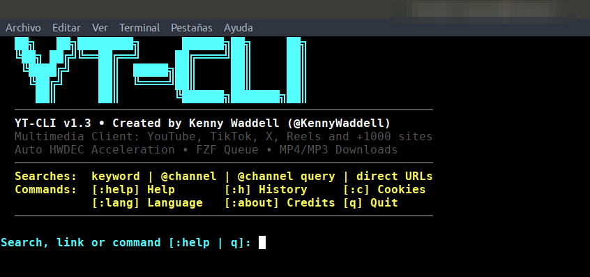

# 🎬 YT-CLI

<p align="center">
  <b>English</b> • <b><a href="README.es.md">Leer en Español</a></b>
</p>

> **Ultralight Terminal Multimedia Client for Linux & Standalone Portable GUI for Windows**  
> Specifically engineered for resource-constrained systems (Intel Celeron, Atom, vintage ThinkPads, and PCs with 2 GB RAM). Compatible with Linux and Windows 7 SP1, 8.1, 10, and 11.

[](LICENSE)
[](#system-requirements)
[](#quick-installation-on-linux)
[-orange.svg)](#windows-portable-standalone-usage)
[](#key-features)

<p align="center">
  
</p>

---

## ⚡ The Problem It Solves

Modern web browsers (Brave, Chrome, Firefox) typically consume between **900 MB and 1.4 GB of RAM** just to open YouTube, driving dual-core CPUs to **100% utilization** due to bloated JavaScript bundles, telemetry, and heavyweight DOM rendering. On older machines, this results in system freezing, screaming cooling fans, and dropped frames.

**YT-CLI** cuts the web browser entirely out of the equation:
* Instant plain-text search driven by **FZF**.
* Streams the multimedia feed directly to **MPV**.
* Hardware-agnostic GPU decoding (`--hwdec=auto-safe`: Intel VA-API, AMD Mesa, Nvidia NVDEC) capped at **H.264 (AVC) up to 30 fps** to protect legacy processors from taxing VP9 or AV1 software decoding.

| Metric | YouTube in Web Browser | YT-CLI + MPV |
| :--- | :--- | :--- |
| **RAM Consumption** | ~1,100 MB (1.1 GB) | **~75 MB - 110 MB** (90% savings) |
| **CPU Usage during Playback** | 80% - 100% (Thermal throttling & lags) | **15% - 25%** (Smooth 30/60 fps) |
| **Audio-Only Mode (Podcast/Music)** | 600 MB - 800 MB | **~25 MB** |
| **Privacy** | Tracking cookies & cloud analytics | **100% Private (Zero telemetry / Local-only history)** |

---

## 🥊 How Does YT-CLI Differ from ytfzf?

If you are familiar with terminal tools like `ytfzf`, here is how `YT-CLI` compares:

1. **Zero Configuration Out-of-the-Box:** `ytfzf` requires extensive shell scripting and manual configuration files to throttle formats on older hardware. `YT-CLI` comes pre-configured with H.264 filters and safe hardware acceleration (`auto-safe`) from the first second.
2. **Unified Cross-Platform Suite:** `ytfzf` is limited to POSIX systems (Linux/macOS/BSD). `YT-CLI` provides both a pure Linux terminal CLI and a native, zero-install portable graphical application (`YT-CLI.exe`) for Windows 7, 8.1, 10, and 11.
3. **Integrated Download & Playlist Manager:** While `ytfzf` focuses primarily on playback, `YT-CLI` includes a built-in download engine with destination folder selection (including mounted USB flash drives), automatic download resumption (`--continue`), MP3 audio extraction (320 kbps) with embedded cover art and ID3 tags, and MP4 video downloads.
4. **Creator & Channel Search Syntax:** Direct search inside specific YouTube channels by typing `@channel` or `@channel query`.
5. **UNIX Philosophy (No Terminal Graphics Hacks):** Tools that attempt to render thumbnails inside terminal emulators often suffer from distorted fonts, broken aspect ratios, and visual flickering during dynamic FZF filtering. Following the UNIX philosophy (*"Do one thing and do it well"*), `YT-CLI` keeps the Linux client purely text-based, instant, and distraction-free, reserving native visual cards for the Windows GUI.

---

## ✨ Key Features

* 🔍 **Ultra-Fast Interactive Search:** Filter videos in real time by title, duration, and uploader using `fzf`.
* 🎶 **Queue & Multi-Selection:** Mark multiple videos or songs with `Tab` in `fzf` to stream sequentially in MPV (`>` next / `<` prev) or download them in batch.
* 📋 **Smart Clipboard Detection:** If you copy a YouTube, TikTok, or Twitter/X link before launching `yt-cli`, it detects it and offers to open or download it immediately.
* 🔄 **Persistent Results & Safe Navigation:** When a video finishes (or you press `q`), the search list **reappears instantly**. If you select a video by mistake, option `[0]` lets you return to your results with zero delay.
* 📺 **Smart Resolution Selector:**
  * **720p HD at 30fps:** Optimal balance for laptop displays and low CPU usage (Default).
  * **1080p Full HD:** GPU-accelerated H.264 (with automatic fallback to 720p if H.264 is unavailable).
  * **480p / 360p:** For slow connections or extreme power saving.
  * **Audio Only:** Ideal for podcasts, tutorials, or background music (~25 MB RAM).
* ⬇️ **Smart & Resumable Downloads:**
  * **Chapter Splitting (`--split-chapters` / `-s`):** Automatically split albums, podcasts, and courses into separate individual tracks without re-encoding.
  * **Native Audio Formats:** Download in native **M4A/AAC** or **Opus** (direct stream copy from YT with official cover art, zero quality loss) or standard **MP3** (320k, 192k, 128k) and **FLAC**.
  * **Safe Download Archive:** Automatically keeps track of downloaded files (`--download-archive`), ensuring batch playlist and channel downloads skip already downloaded media without wasting bandwidth.
  * **Automatic Resumption:** Network drops automatically resume where they left off (`--continue`).
  * **Folder Selector:** Save directly to system folders, external USB flash drives, or custom paths.
  * **MP4 Videos:** Universally compatible H.264 up to 1080p with embedded thumbnails.
  * **Playlist Support:** Download full YouTube playlists in batch.
* 🔄 **Built-in yt-dlp Updater:** Type `:u` or `:update` in the prompt (or run `yt-cli -u`) to instantly check and update `yt-dlp` to the latest official release whenever YouTube algorithms change.
* 📜 **Local History & Playback Resume:** Remembers watched videos (`yt-cli -H` or `:h`) with LRU ordering and resumes playback at the exact second you left off (`--save-position-on-quit`). 100% private and stored locally.
* 🍪 **Browser Cookie Support:** Bypass age restrictions and bot check gates by passing session cookies from Brave, Chrome, Firefox, or Edge (`-c brave` / dropdown in GUI).
* 🌐 **Bilingual System (Spanish & English):** Native internationalization with automatic OS language detection, runtime switcher (`:lang`), and CLI flag (`--lang`).
* 🪟 **Portable Windows GUI:** Standalone zero-install executable for Windows 7 SP1, 8.1, 10, and 11 with dark/light themes, progress bars, and dedicated audio mode.
* 🔔 **Desktop Notifications:** Native non-blocking desktop notifications upon download completion.

---

## 📋 System Requirements

Requires standard Linux utilities:
* `bash` (v4.0+)
* `yt-dlp` (Multimedia extraction engine)
* `fzf` (Interactive terminal search engine)
* `mpv` (High-performance media player)
* `ffmpeg` (Audio conversion and packaging)

### Dependency Installation:

* **Debian / Ubuntu / antiX / Linux Mint:**
  ```bash
  sudo apt update && sudo apt install yt-dlp fzf mpv ffmpeg
  ```

> [!TIP]
> On distributions like Debian, Ubuntu LTS, or Linux Mint, the `yt-dlp` version in `apt` repositories may be outdated compared to frequent YouTube API updates. If you experience extraction errors, install `yt-dlp` via `pipx` or use its official binary:
> ```bash
> # Recommended via pipx:
> sudo apt install pipx && pipx install yt-dlp
> # Or standalone official binary:
> sudo wget https://github.com/yt-dlp/yt-dlp/releases/latest/download/yt-dlp -O /usr/local/bin/yt-dlp && sudo chmod a+rx /usr/local/bin/yt-dlp
> ```

* **Arch Linux / Manjaro:**
  ```bash
  sudo pacman -S yt-dlp fzf mpv ffmpeg
  ```
* **Fedora:**
  ```bash
  sudo dnf install yt-dlp fzf mpv ffmpeg
  ```

---

## 🚀 Quick Installation on Linux

1. Clone the repository:
   ```bash
   git clone https://github.com/KennyWaddell/yt-cli.git
   cd yt-cli
   ```

2. Run the installer:
   ```bash
   chmod +x install.sh
   ./install.sh
   ```

The installer respects your system configuration:
1. Installs the binary to `~/.local/bin/yt-cli`.
2. Installs language packs to `~/.local/share/yt-cli/lang/`.
3. Registers the application menu entry with official icon (`~/.local/share/applications/yt-cli.desktop`).
4. Asks before creating any desktop shortcuts (never creates them forcefully).
5. Uses an isolated configuration folder at `~/.config/yt-cli/` without modifying global `~/.config/yt-dlp/` dotfiles.

---

## 💻 Usage

### 1. Interactive Console (Recommended)
Run in any terminal:
```bash
yt-cli
```
1. Type keywords or paste a link.
2. Navigate with arrow keys and press `Enter` (or `Tab` to select multiple).
3. Choose your playback or download quality.

### 2. Direct Search or Channel Filtering
```bash
# General search:
yt-cli "linux kernel news"

# View recent videos from a channel:
yt-cli "@ThePrimeTimeagen"

# Search inside a specific channel:
yt-cli "@ThePrimeTimeagen neovim"
```

### 3. Podcast / Audio-Only Mode
```bash
yt-cli -a "lofi hip hop radio"
```

### 4. Direct Link Downloads
```bash
# Download video in MP4 (720p H.264):
yt-cli -d "https://www.youtube.com/watch?v=..."

# Download song in MP3 (320 kbps):
yt-cli -m "https://www.youtube.com/watch?v=..."

# Supports TikTok, Twitter/X, Reels, etc.:
yt-cli -d "https://www.tiktok.com/@user/video/..."
```

### 5. Switching Languages
```bash
# Set language via command line:
yt-cli --lang en
yt-cli --lang es

# Or inside the interactive console, type:
:lang en
:lang es
```

---

## 🪟 Windows Portable Standalone Usage

YT-CLI provides an official, native standalone package for **Windows 7 SP1, 8.1, 10, and 11 (64-bit)**. It does not require installing Python, configuring dependencies, or modifying system `PATH`.

### Quick Steps:
1. Go to [**Releases**](https://github.com/KennyWaddell/yt-cli/releases) and download **`YT-CLI-Windows-Portable.zip`**.
2. Extract the `.zip` archive to any folder.
3. Double-click **`YT-CLI.exe`** to launch immediately.
4. *(Optional)* Right-click `YT-CLI.exe` -> *Send to* -> *Desktop (create shortcut)*.

---

## ⌨️ MPV Player Shortcuts

| Key | Action |
| :--- | :--- |
| `q` | Close video and return instantly to search results |
| `Space` | Pause / Resume |
| `f` | Toggle Fullscreen |
| `9` / `0` | Decrease / Increase Volume |
| `←` / `→` | Seek backward / forward 5 seconds |
| `>` / `<` | Next / Previous video in playback queue |
| `i` | Show resolution, fps, and active codec on-screen |
| `Shift + i` | Full technical statistics (GPU acceleration, dropped frames, cache) |

---

## ❓ Frequently Asked Questions (FAQ)

<details>
<summary><b>1. Why not just use a web browser with uBlock Origin?</b></summary>
<br>
Ad blockers are fantastic, but they do not eliminate the underlying Chromium or Gecko browser engine. The browser still has to parse megabytes of complex JavaScript, compute layout reflows on the DOM tree, and manage dozens of multi-process tabs. On budget machines (2 to 4 GB RAM, dual-core CPU), this causes memory usage exceeding 1 GB and heavy CPU throttling. <b>YT-CLI + MPV</b> streams raw hardware-decoded multimedia without browser bloat, using only ~75 MB of RAM.
</details>

<details>
<summary><b>2. Why doesn't YT-CLI include thumbnail preview in Linux terminal?</b></summary>
<br>
Adhering to the UNIX philosophy (<i>"Do one thing and do it well"</i>) and technical reliability: standard Linux terminal emulators (such as <code>xfce4-terminal</code>, GNOME Terminal, or unpatched Alacritty) display Unicode block characters or protocols like Kitty/Sixel inconsistently, resulting in vertical stretching, line wrapping artifacts, and visual flickering during dynamic FZF searches. For visual cards and rich thumbnails, YT-CLI provides a native Windows GUI; while the Linux client is engineered to be rock-solid, lightning-fast, and 100% usable even over SSH or pure TTYs.
</details>

<details>
<summary><b>3. Does it run on legacy hardware (Intel Celeron, Atom, ThinkPads with 2 GB RAM)?</b></summary>
<br>
Yes, absolutely. YT-CLI was designed specifically for low-resource computers. By defaulting to H.264 (AVC) video capped at 30 fps with <code>--hwdec=auto-safe</code>, it prevents the CPU from melting under modern VP9 or AV1 software decoding. It also includes 480p and 360p modes and a dedicated audio mode consuming only ~25 MB of RAM.
</details>

<details>
<summary><b>4. How do I switch interface language between Spanish and English?</b></summary>
<br>
YT-CLI automatically detects your operating system language (from <code>$LANG</code>), but you can switch anytime:
<ul>
  <li>Inside the interactive prompt: type <code>:lang</code> (or <code>:lang en</code> / <code>:lang es</code>).</li>
  <li>From the terminal on launch: run <code>yt-cli --lang en</code> or <code>yt-cli --lang es</code>.</li>
</ul>
Your choice is persisted in <code>~/.config/yt-cli/config</code>.
</details>

<details>
<summary><b>5. How do I bypass age restrictions or bot detection gates?</b></summary>
<br>
You can pass session cookies from your browser so YouTube recognizes your logged-in session securely:
<ul>
  <li>In interactive prompt: type <code>:c</code> and enter your browser name (e.g. <code>brave</code> or <code>firefox</code>).</li>
  <li>From terminal launch: run <code>yt-cli -c brave "search keywords"</code> or <code>yt-cli -c /path/to/cookies.txt</code>.</li>
</ul>
</details>

<details>
<summary><b>6. What should I do if YouTube updates its API and videos stop loading?</b></summary>
<br>
YouTube updates its cipher signatures periodically. You never need to reinstall YT-CLI; you only need to update the <code>yt-dlp</code> backend:
<pre><code># If installed via pipx:
pipx upgrade yt-dlp

# If using standalone official binary:
sudo yt-dlp -U
</code></pre>
</details>

<details>
<summary><b>7. How can I contribute a translation to my language?</b></summary>
<br>
Community translations are warmly welcomed! The localization system is modular and flat:
<ol>
  <li>Open the <code>lang/</code> directory in the repository.</li>
  <li>Copy the base template <code>lang/en.sh</code> (e.g., <code>lang/pt.sh</code> for Portuguese, <code>lang/de.sh</code> for German, etc.).</li>
  <li>Translate the strings inside quotes while keeping the variable names intact.</li>
  <li>Submit a <b>Pull Request</b> on GitHub to have it included in the next release!</li>
</ol>
</details>

---

## 🗺️ Roadmap

- [x] Resumable download support (`-c` / `--continue`).
- [x] Interactive destination folder selector (local storage, mounted USB drives, custom paths).
- [x] Multi-selection queue in FZF (`Tab` key).
- [x] Smart clipboard detection and desktop notifications.
- [x] Local history with playback position resumption (`--save-position-on-quit` & `--watch-later-options=start`).
- [x] Browser session cookies support (Brave, Firefox, Chrome, Edge).
- [x] Cross-platform native standalone GUI for **Windows 7 / 8.1 / 10 / 11**.
- [x] Standalone PyInstaller build script for portable `YT-CLI.exe`.
- [x] Isolated dotfiles (`~/.config/yt-cli`) and desktop privacy etiquette (v1.2).
- [x] Hardware-agnostic GPU acceleration (`--hwdec=auto-safe`: Intel VA-API, AMD Mesa, Nvidia NVDEC) with 720p/1080p unlock (v1.2).
- [x] Wayland (`wl-paste`) and X11 (`xclip` / `xsel`) clipboard detection (v1.2).
- [x] Creator & channel search filtering (`@channel` or `@channel query`) (v1.2).
- [x] Modular bilingual internationalization (Spanish & English in `lang/`, `--lang`, `:lang`) (v1.3).
- [ ] Integrated `yt-dlp` self-updater from CLI command and GUI button (v1.3).
- [ ] Custom user configuration presets (v1.3).
- [ ] Optional SponsorBlock integration (v1.3).

---

## 📄 License

This project is licensed under the **GNU General Public License v3.0 (GPLv3)**. See the [LICENSE](LICENSE) file for details.  
Knowledge and software belong to the community.

---

## 👤 Author

Developed and maintained by **Kenny Waddell**  
* GitHub: [@KennyWaddell](https://github.com/KennyWaddell)  
* *Developed in collaboration and optimization with Antigravity (Google DeepMind).*
